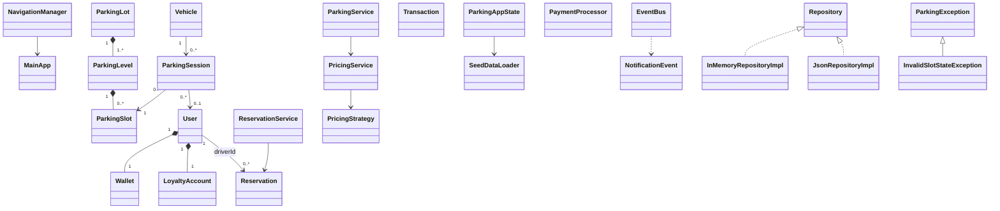

# Parking Management System

Java 17/JavaFX 21 desktop parking management application. The system supports role-based access, multi-level slot operations, reservations, QR tickets, checkout receipts, locked INR pricing, audit reports, CSV/PDF export, and JSON persistence.

## Requirements

- JDK 17+
- Maven 3.9+

## Build, test, and run

```bash
mvn clean test
mvn javafx:run
```
The Maven entry point is `com.parking.app.MainApp`. Seed data is loaded in memory by `SeedDataLoader`; JSON persistence is available through `RepositoryFactory` and `JsonRepositoryImpl`.

## Demo credentials

There is no password field or password authentication in the implemented UI. Use one of these seeded user IDs in the login screen:

| Role | User ID | Landing view |
|---|---|---|
| Driver | `driver-1` | Driver dashboard |
| Attendant | `attendant-1` | Attendant dashboard |
| Administrator | `admin-1` | Admin dashboard |

These are deterministic seed identifiers, not production credentials.

## Professor demo script

1. Start the application and choose **Continue**.
2. Log in as `driver-1`; show role-based routing to the driver dashboard.
3. Open **Slot map** and show available, occupied, and out-of-service slots.
4. Open **Reservations**, select an available slot, enter `driver-1`, and confirm; show the pricing line items.
5. Open **Check in**, search for a reservation or driver, and generate a QR ticket.
6. Open **Check out & payment**, enter the ticket/session ID, select Cash/Card/Wallet, and generate the receipt.
7. Open **Notifications** and demonstrate the event-bus success notification.
8. Log out and log in as `admin-1`.
9. Demonstrate slot maintenance, pricing configuration, user management, and audit/report export.
10. In **Pricing configuration**, simulate one hour and point out that the rates and ten-step pricing chain are locked in code.

## Pricing and grading checklist

- [x] Locked INR hourly rates in `PricingConfig`: Compact ₹30.00, Standard ₹50.00, Large ₹70.00, Accessible ₹50.00, Electric ₹60.00.
- [x] Exact ten-step pricing chain in `PricingService`: `BaseRateStrategy` → `SurgeStrategy` → `PeakHourStrategy` → `WeekendHolidayStrategy` → `EvDiscountStrategy` → `ReservationFeeStrategy` → `PromoCodeStrategy` → `LoyaltyRedemptionStrategy` → `OverstayPenaltyStrategy` → `TaxStrategy`.
- [x] `TaxStrategy` applies the configured 18% GST after the preceding nine steps.
- [x] `InvalidSlotStateException`: rejects illegal `ParkingSlot` state transitions.
- [x] `SlotUnavailableException`: rejects entry into missing, occupied, or unavailable slots.
- [x] `ReservationConflictException`: rejects a second confirmed reservation for the same slot.
- [x] `DataPersistenceException`: reports JSON repository read/write failures and backup failures.
- [x] `InvalidPaymentException`: domain exception reserved for invalid payment processing paths.
- [x] `ParkingException` is the common runtime base for the custom parking exceptions.

## Architecture

The application is organized into JavaFX controllers/views, MVVM view models, domain models/services, repositories, and persistence services. `NavigationManager` loads FXML screens and routes users by `Role`; `ParkingAppState` exposes the seeded application state; `EventBus` delivers UI notifications.

## UML and design documentation

- [Final class diagram](class-diagram.mmd)
- [Final use-case diagram](usecase-diagram.mmd)
- [Final navigation map](navigation-map.mmd)
- [Vehicle entry sequence](sequence-vehicle-entry.mmd)
- [Vehicle exit/payment sequence](sequence-vehicle-exit-payment.mmd)
- [Reservation sequence](sequence-reservation.mmd)
- [ParkingSlot lifecycle state diagram](state-parking-slot.mmd)
- [OOP and pattern mapping report](OOM_PATTERN_MAPPING.md)

### Class diagram


