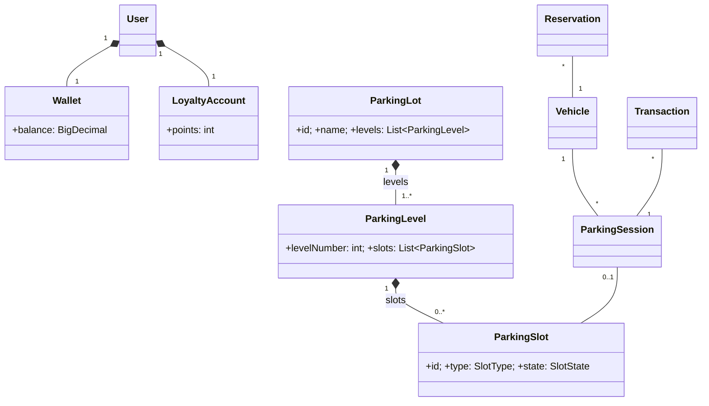
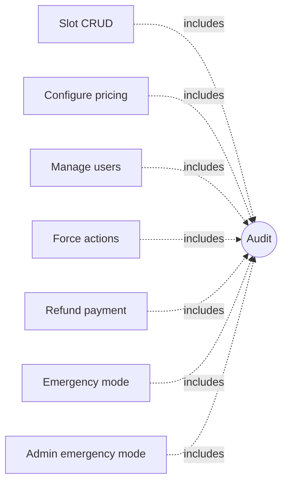
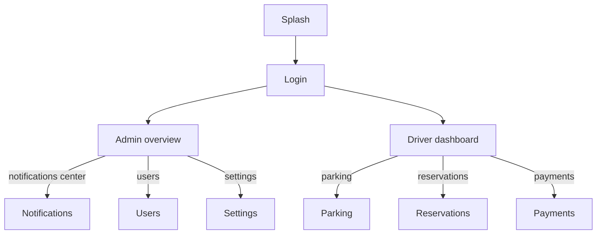

# Qubes Issues repository

This repository tracks issues and feature development progress for the [Qubes OS Project](https://www.qubes-os.org/). Please take a moment to read the following important information:

- [Issue tracking](https://doc.qubes-os.org/en/latest/introduction/issue-tracking.html)
- [Contributing](https://doc.qubes-os.org/en/latest/introduction/contributing.html)
- [Help, support, mailing lists, and forum](https://doc.qubes-os.org/en/latest/introduction/support.html)
- [Code of conduct](https://doc.qubes-os.org/en/latest/introduction/code-of-conduct.html)
- [Terms of use](https://www.qubes-os.org/terms/)

You can [file a new issue](https://github.com/QubesOS/qubes-issues/issues/new/choose) or [view all issues](https://github.com/QubesOS/qubes-issues/issues).

## Notable issues

- [Good first issue](https://github.com/QubesOS/qubes-issues/issues?q=is%3Aopen+is%3Aissue+label%3A%22good+first+issue%22)
- [Help wanted](https://github.com/QubesOS/qubes-issues/issues?q=is%3Aopen+is%3Aissue+label%3A%22help+wanted%22)
- [Community-developed](https://github.com/QubesOS/qubes-issues/issues?q=is%3Aissue+is%3Aopen+label%3A%22community+dev%22)

## High-priority issues

- [Blocker](https://github.com/QubesOS/qubes-issues/issues?q=is%3Aopen+is%3Aissue+label%3A%22P%3A+blocker%22)
- [Critical](https://github.com/QubesOS/qubes-issues/issues?q=is%3Aopen+is%3Aissue+label%3A%22P%3A+critical%22)

## Components status

- [Component build status by release (Gitlab-CI)](https://qubesos.gitlab.io/qubes-g2g-report/)
- [Component build status by release (Travis-CI)](travis_status.md) (obsolete)

## GitHub help

- [GitHub Docs: Searching issues and pull requests](https://docs.github.com/en/search-github/searching-on-github/searching-issues-and-pull-requests)
- [GitHub Docs: Understanding the search syntax](https://docs.github.com/en/search-github/getting-started-with-searching-on-github/understanding-the-search-syntax)

## Parking Management System — Phase 1 diagrams

### Class diagram

### Use-case diagram

### Navigation map

